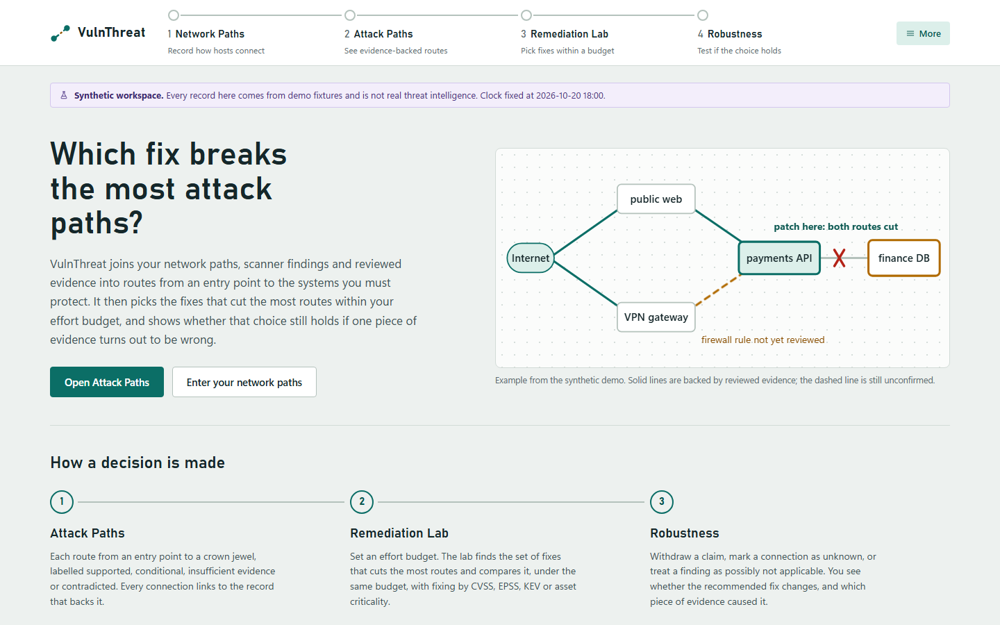
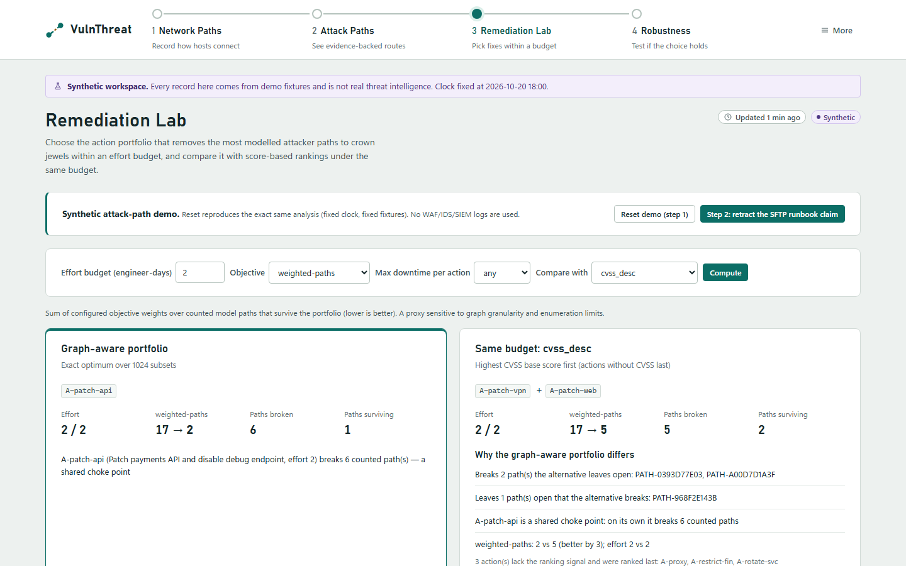
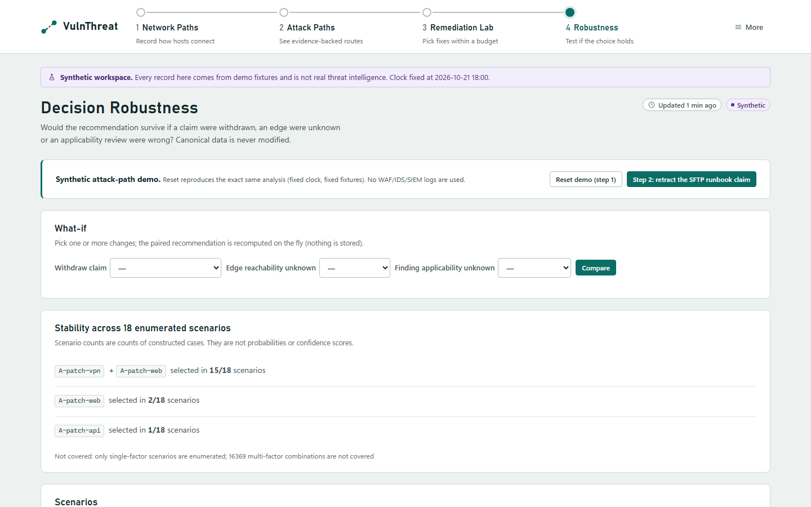

<div align="center">

# VulnThreat

**Which fix breaks the most attack paths, and does that choice survive if a piece of evidence is wrong?**

Your network paths + scanner findings + reviewed evidence → evidence-backed attack paths → the fixes that cut the most of them within your effort budget.



</div>

## New in v2: evidence-grounded attack paths and counterfactual patch triage

**Try it in the browser (no install):** https://d01ki.github.io/VulnThreat/ — a read-only, pre-rendered snapshot of the synthetic demo (steps 1 and 2). Imports, editing and arbitrary what-if combinations need the local tool.

No WAF, IDS or SIEM logs. No API keys. No exploit execution.

1. **Attack Paths**: model paths from entry points to crown jewels, built from your topology, findings and structured preconditions. Each path is `supported`, `conditional`, `insufficient_evidence` or `contradicted`, and every edge links to its evidence.
2. **Remediation Lab**: the action portfolio that breaks the most modelled paths within an effort budget (exact search for small catalogues), compared under the *same* budget with CVSS-, EPSS-, KEV-first, criticality and graph-only rankings.
3. **Decision Robustness**: what if a claim is retracted, an edge is unknown or an applicability review is wrong? See which recommendation flips, and exactly why.

```powershell
uv sync
uv run tiw demo seed --scenario attack-path      # synthetic, offline, fixed clock
uv run tiw serve --data-dir .tiw-demo            # http://127.0.0.1:8787/attack-paths
uv run tiw triage optimize --budget 2 --data-dir .tiw-demo
```

Expected: the graph-aware optimum patches the shared payments-API choke point (weighted paths 17 → 2), while highest-CVSS-first under the same budget leaves 5. Retracting one runbook claim flips the recommendation, and the decision diff names the claim. Walkthrough: [Arsenal demo](docs/ARSENAL_DEMO.md).

With your own data you provide `assets.csv`, `findings.csv` and your network paths. Enter the paths on the **Network Paths** screen, or as a simple CSV with one row per connection (`source,target,ports,reachability,evidence_ref,reviewer`). The rest can be drafted from your findings:

```powershell
uv run tiw import assets assets.csv; uv run tiw import findings findings.csv
uv run tiw import topology-csv edges.csv    # or use the Network Paths screen
uv run tiw draft all --import      # exploit conditions + remediations, unreviewed placeholders
uv run tiw triage optimize --budget 3
```

Paths are hypotheses over recorded data, not observed attacks. CVSS, EPSS and KEV are not breach probabilities; scenario counts are not confidence scores.

| Remediation Lab | Decision Robustness |
|---|---|
|  |  |

## What it does

1. **You load** your assets and the CVEs your scanner found on them (CSV).
2. **It collects** evidence: the CISA KEV catalog, EPSS scores, reviewed advisories, and attacks your IDS/WAF saw.
3. **It decides** an action per asset (respond, patch, investigate, or monitor), with an urgency and the reason.
4. **It explains** every change: before and after, the evidence that moved it, and what is still unconfirmed.

## Why it's different

- **Evidence, not scores.** Exploited publicly? Attacked here? Exposed? Each is shown on its own.
- **Reposts don't count twice.** Ten articles citing one rumour are still one rumour.
- **Unknown stays unknown.** Missing data never becomes "safe". A scan is never treated as a breach.
- **History is never rewritten.** Corrections are added; old decisions stay comparable.
- **Local by design.** No API keys and no LLM. The only outbound requests are KEV/EPSS downloads that you start.

## Run it

```powershell
docker build -t threat-workbench .
docker run -d --name threat-workbench -p 127.0.0.1:8787:8787 -v tiw-data:/data threat-workbench
```

Open http://127.0.0.1:8787 and follow **Get started**: import assets → import findings → **Fetch KEV**.
Your data persists in the `tiw-data` volume.

<details>
<summary>Try the demo instead (synthetic data)</summary>

```powershell
docker run --rm -p 127.0.0.1:8788:8787 -e TIW_MODE=demo threat-workbench
```
Open http://127.0.0.1:8788. This serves the attack-path demo; add `-e TIW_DEMO_SCENARIO=legacy` for the original scenarios A–D.
</details>

<details>
<summary>Without Docker</summary>

```powershell
uv sync
uv run tiw init
uv run tiw import assets assets.csv
uv run tiw import findings findings.csv
uv run tiw fetch kev
uv run tiw serve            # http://127.0.0.1:8787
```
</details>

## Docs

[Overview](docs/en/overview.md) · [Installation](docs/en/installation.md) · [Usage](docs/en/usage.md) · [Status](docs/IMPLEMENTATION_STATUS.md)

v2: [Architecture](docs/ARCHITECTURE_V2.md) · [Data formats](docs/DATA_FORMATS_V2.md) · [Arsenal demo](docs/ARSENAL_DEMO.md) · [Research evaluation](docs/RESEARCH_EVALUATION.md) · [Status](docs/IMPLEMENTATION_STATUS_V2.md) · [Roadmap](docs/ROADMAP_V2.md)

<sub>CLI: `tiw` · License: not yet decided (the repository has no LICENSE file)</sub>
