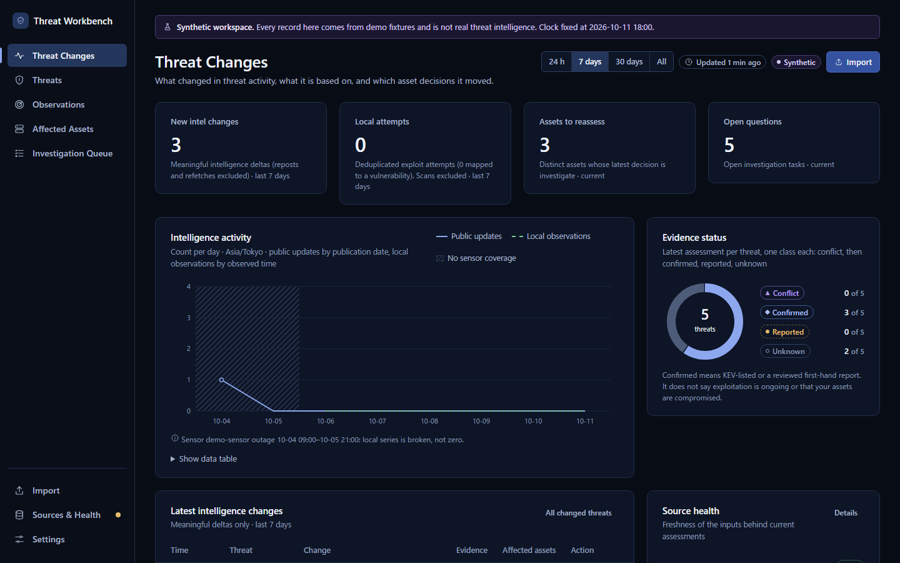

<div align="center">

# Threat Workbench

**Know which of your assets need action, and why.**

Public exploitation reports + attacks seen on your own sensors → a clear, explainable decision for every asset.



</div>

## Why

New threat reports keep arriving. Most are reposts, some are retracted, and few apply to your systems. Threat Workbench keeps the evidence, ignores the noise, and shows you exactly which decision changed and why.

- **Evidence, not scores.** Exploited publicly? Attacked locally? Exposed? Each is shown on its own; nothing is hidden in a magic number.
- **Reposts don't count twice.** Ten articles citing one rumour are still one rumour.
- **Unknown stays unknown.** Missing data never turns into "safe". A scan is never treated as a breach.
- **Every decision has a diff.** You see before and after, the evidence that changed, and the rule that applied.
- **Offline and local.** No API keys and no LLM. Nothing leaves your machine.

## Run it

```powershell
docker build -t threat-workbench .
docker run --rm -p 127.0.0.1:8787:8787 threat-workbench
```

Open http://127.0.0.1:8787. The image starts with a synthetic demo (four scenarios).

<details>
<summary>Without Docker</summary>

```powershell
uv sync
uv run tiw demo seed --scenario all
uv run tiw demo advance --step 4
uv run tiw serve --data-dir .tiw-demo
```
</details>

## Docs

[Overview](docs/en/overview.md) · [Installation](docs/en/installation.md) · [Usage](docs/en/usage.md) · [Status](docs/IMPLEMENTATION_STATUS.md)

<sub>CLI: `tiw` · License: Apache-2.0 (candidate) · Demo data is synthetic (`DEMO-VULN-###`).</sub>
