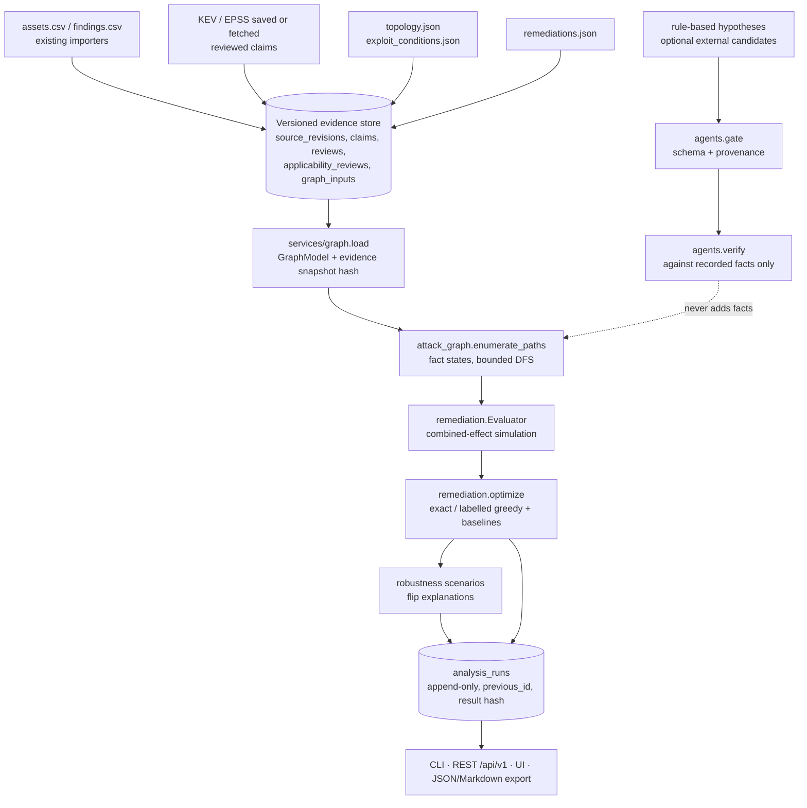

# Architecture v2: evidence-grounded attack paths and counterfactual triage

## Layers

| Layer | Modules | Rules |
|---|---|---|
| Domain (pure) | `domain/attack_graph.py`, `domain/remediation.py`, `domain/robustness.py`, `domain/agents.py` | No IO, no clock, no randomness. Frozen dataclasses; scenarios build copies |
| Adapters | `adapters/graph_inputs.py`, `adapters/claims.py` (graph predicates) | Parse + validate structure only; unknown keys rejected |
| Services | `services/graph.py` (load model), `services/triage.py` (analyses, runs, diffs), `services/analysis_export.py`, `services/demo.py` | DB reads/writes, recorded runs |
| Storage | `graph_inputs`, `analysis_runs` (migration `0002_attack_graph`) | Append-only, guarded at the ORM level |
| Interfaces | `cli/v2.py`, `api/rest_v2.py`, `api/web_v2.py`, `templates/*` | GET never writes; POSTs need CSRF (UI) or bearer token (API) |

## Semantics

### Nodes and edges

- `entry_point` (e.g. Internet) grants an abstract capability (`network_access`).
- `asset` nodes are imported assets. `security_objective`s (crown jewels) reference an asset and carry a **configured integer weight**; weights are never derived from CVSS or EPSS.
- A `network` edge is *potential* reachability on listed ports. A hop across it requires an imported finding on the target whose `service_ports` intersect the edge ports and whose `requires_capability` is held. The hop grants the finding's `grants_capability` (abstract state, not proof).
- A `trust` edge (e.g. stored credentials) needs a capability on the source and grants one on the target without a vulnerability.
- Capabilities are ordered `network_access < user_context < code_execution < admin_context`; `credential_access` and `data_access` only match themselves.

### Facts and evidence

Every hop depends on facts: `edge:<id>` (reachability), `applicability:<finding>`, `cond:<vuln>:<condition>`. Each fact holds evidence items with a polarity:

- the topology/conditions record itself (active only if `review_state` is `reviewed`, expires at `valid_until` / `expires_at`);
- linked claims (`claim:<key>`): active only if effectively `reviewed` and not retracted, rejected, superseded or an older revision;
- applicability reviews (`affected` supports, `not_affected` refutes).

Resolution (deterministic, no majority voting):

| Active supporting | Active refuting | Other | Fact status |
|---|---|---|---|
| ≥1 | ≥1 | | `disputed` |
| 0 | ≥1 | | `refuted` (hop removed, listed as blocked) |
| ≥1 | 0 | | `satisfied` |
| 0 | 0 | declared unknown, or support expired, or refutation withdrawn | `unknown` |
| 0 | 0 | asserted satisfied but no active support | `unsupported` |

Path status = worst fact: `contradicted` (disputed) > `insufficient_evidence` (unsupported) > `conditional` (unknown) > `supported`.

### Inclusion policies

| Policy | Counted path states | Meaning |
|---|---|---|
| `as_recorded` (default) | supported, conditional, contradicted | Unknown is not safe; disputes are not voted away. Insufficient-evidence paths are excluded **and listed** |
| `pessimistic` | + insufficient_evidence | Sensitivity bound |
| `optimistic` | supported only | Sensitivity bound |

### Objective and optimiser

- `weighted-paths`: sum of objective weights over counted surviving paths. `reachable-targets`: number of objectives with ≥1 counted surviving path. Lower is better. Both are proxies sensitive to graph granularity.
- Actions (`patch_finding`, `disable_service`, `restrict_edge`, `isolate_asset`, `enabler`) only remove edges, ports or findings, so a portfolio's surviving set is exactly the enumerated paths with no removed hop: the **combined effect**, never a sum of single effects.
- Feasibility: integer budget, optional per-action downtime cap, `requires` dependencies, one action per `conflict_group`.
- ≤16 eligible actions: exhaustive subset search (exact). Above: greedy marginal gain per effort, labelled `approximate-greedy` with unknown optimality gap (compared with exact on random small graphs in `tests/unit/test_remediation.py`).
- Tie-breaking: objective → other objective → effort → max downtime → number of actions → sorted action ids.
- The chosen portfolio is re-simulated on the modified graph; a mismatch (possible only under truncation) is reported.

### Baselines (same budget, actions, constraints and evaluator)

`cvss_desc`, `epss_desc`, `kev_first`, `criticality_exposure` (ranked greedy fill, dependencies added when affordable, missing signals ranked last and disclosed) and `graph_only` (optimiser over declared topology with provenance ignored). policy-v1 is not described as SSVC.

### Robustness

Single-factor scenarios built from evidence cited by counted paths: `withdraw_claim`, `reachability_unknown`, `applicability_unknown`, `stale_evidence` (clock + N days), `pessimistic`, `optimistic`; capped at 12 per kind with uncovered counts reported. Each scenario re-runs the optimiser; flips list every changed path and the facts/evidence ids behind it. "Selected in k/n scenarios" is a count of constructed cases, **not a probability**.

### Reproducibility

`evidence_hash` = SHA-256 over input content hashes, every fact with its evidence, asset/vulnerability context and the evaluation clock. Evidence ids are stable (`claim:<key>`, `topology:<edge>`, `applicability:<finding>#<seq>`), so two fresh demo workspaces yield byte-identical normalized JSON (tested). Timing lives in `diagnostics` and is excluded from hashes.

### AI boundary

`agents.rule_based` produces candidates deterministically. External candidates (file or API) pass `agents.gate` (strict keys, schema version, known nodes and findings, no fabricated evidence ids, capped text) and `agents.verify` (match against recorded edges and findings only). Nothing is executed and nothing is persisted as a fact, so optimiser output is identical with AI disabled.
